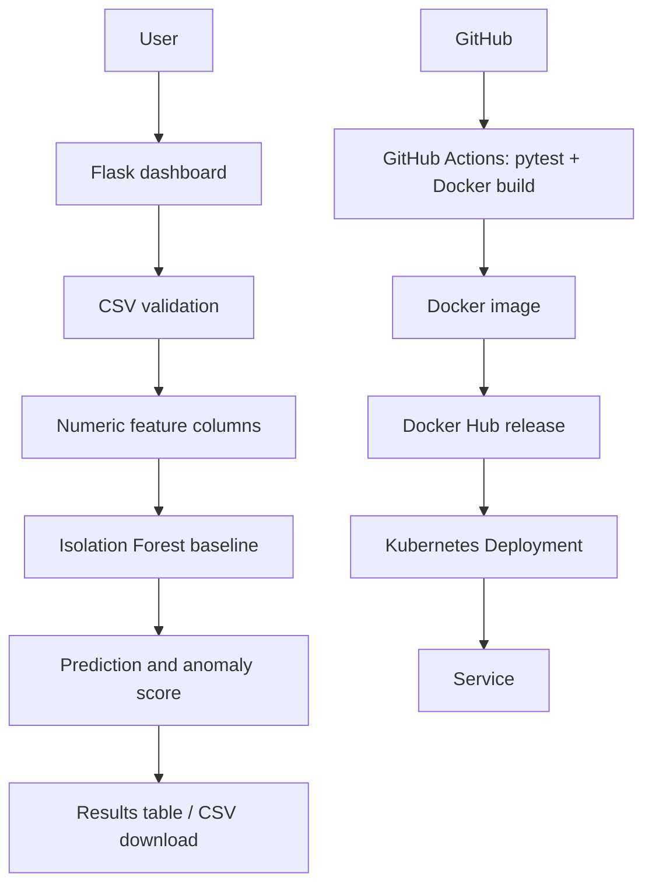

# Architecture

Three tiers: presentation (HTML/CSS rendered by Flask); application (validation, prediction, export); model/data (scikit-learn pipeline). This starter does not parse raw HDFS logs.
## Scope warning
The previously discussed Linear SVM + LSTM + VQC model set is not implemented in this runnable baseline. Add and evaluate it against the actual SRS after verifying the dataset schema and prediction unit. Disclose this deviation if the SRS requires those models.
